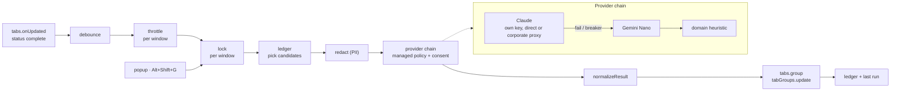
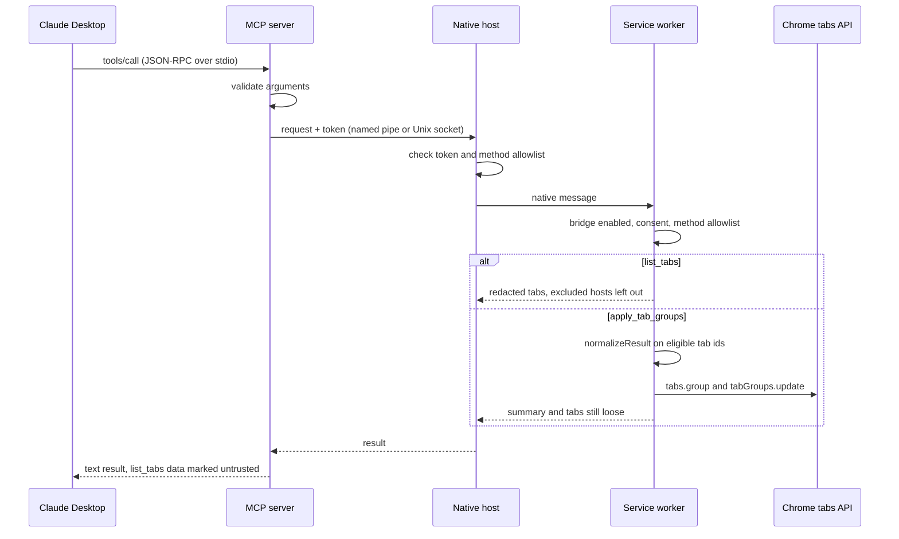

# AI Tab Grouper

[](https://github.com/andreshma/ai-tab-grouper/actions/workflows/ci.yml)
[](https://github.com/andreshma/ai-tab-grouper/actions/workflows/codeql.yml)
[](LICENSE)


A Chrome extension (Manifest V3) that groups your tabs by **topic or task**, automatically while you browse or on demand
from the popup or `Alt+Shift+G`.

It uses a chain of three engines and falls back on its own: the **Claude API** with your own key, **Gemini Nano**
running on-device, and an offline **domain heuristic**. An optional local **MCP bridge** lets **Claude Desktop** list
and group your tabs with your Claude session, with no API key.

> 🔒 **Consent and minimization.** Nothing leaves your device until you accept the data notice. Then only the title, the
> host and (optionally) a redacted path of each tab are sent — never query strings, fragments, page content or cookies.
> Hosts you exclude never leave the device. Without a key the extension still works, fully offline, by domain.
>
> 🌐 **English and Spanish.** The interface follows your browser language (English by default, Spanish when Chrome is in
> Spanish). The documentation quotes the English labels.

📖 **New here? Start with the [usage guide](docs/USAGE.md)**: install, first run, the Claude Desktop bridge, settings and
troubleshooting.

## Contents

- [Why](#why)
- [Quickstart](#quickstart)
- [How it works](#how-it-works)
- [Components](#components)
- [Usage](#usage)
- [Claude Desktop bridge](#claude-desktop-bridge)
- [Configuration](#configuration)
- [Security model](#security-model)
- [Testing](#testing)
- [Status](#status)
- [Documentation](#documentation)
- [Community](#community)
- [License](#license)

## Why

The extension must classify tabs by topic with good quality, work without configuration and not leak sensitive data from
the browsing history ([ADR 0001](docs/adr/0001-hybrid-ai-provider.md)). The design follows from that:

- **It works with no setup.** The domain heuristic never fails and works offline; a model is an upgrade, not a
  requirement. Failures of the Claude API do not block you.
- **No backend.** The extension calls the Claude API directly with your own key, or runs Gemini Nano on the device: zero
  infrastructure and zero operating cost.
- **Your Claude subscription, within the terms.** The bridge lets Claude Desktop use local tools through MCP, so no API
  key and no credentials are handled by the extension ([ADR 0003](docs/adr/0003-claude-desktop-mcp-bridge.md)).
- **Deployable in an organization.** Chrome managed policy can only restrict the extension, and a corporate proxy keeps
  the API key out of the browser ([ADR 0002](docs/adr/0002-enterprise-hardening.md)).

## Quickstart

```bash
git clone https://github.com/andreshma/ai-tab-grouper.git
cd ai-tab-grouper
npm ci
npm run deploy:local      # copies the runtime to ~/ai-tab-grouper (or ATG_DEPLOY_DIR)
```

Open `chrome://extensions`, turn on **Developer mode**, choose **Load unpacked** and select `~/ai-tab-grouper`. Open a
few tabs: they are grouped by domain straight away. To group by topic, open the options page, accept the data notice and
add your Anthropic API key — or connect Claude Desktop.

Requirements: Chrome 120+. Node.js 20+ to build and for the bridge.

## How it works

A grouping run goes from a trigger to tab groups through redaction, the provider chain and validation.



- Tab data is redacted before it goes anywhere, and whatever a model answers is validated before it touches your tabs:
  known tab ids, sanitized names, whitelisted colors.
- A tab you pull out of a group is not regrouped behind your back.
- On demand, tabs that fit no topic go to a collapsed catch-all group ("Misc"; "Varios" in Spanish), so nothing is left
  loose.
- Organizations can restrict the extension through Chrome managed policy, including a corporate proxy that keeps the API
  key out of the browser.
- Default order of the provider chain: Claude → Gemini Nano → domain heuristic. "Prefer on-device over Claude"
  puts Gemini Nano first; the heuristic is always last.
- If every enabled engine is skipped or fails, the chain returns no groups and the popup reports that no engine was
  available.

The module map, the provider chain with its retries and circuit breaker, and every other flow are in
[docs/architecture.md](docs/architecture.md) and [docs/DIAGRAMS.md](docs/DIAGRAMS.md).

## Components

| Component | What it does | Where |
|---|---|---|
| Service worker | Tab events, scheduling, per-window locking, messages from the popup and options pages, bridge handlers | `src/background.js` |
| Configuration | Settings, managed policy overlay (`applyPolicy`), consent version, API-key storage | `src/lib/config.js` |
| Provider chain | Order, skips, fall-through, validation of the result | `src/lib/classifier.js` |
| Model providers | Claude Messages API with a forced tool call · on-device Prompt API with a response schema | `src/lib/providers/claude.js` · `nano.js` |
| Domain heuristic | Offline fallback: groups by registrable domain | `src/lib/heuristic.js` |
| Redaction and validation | What a model may see · what a model may change | `src/lib/redact.js` · `validate.js` |
| Resilience | Retry with backoff and `retry-after`; persisted circuit breaker | `src/lib/resilience.js` |
| Ledger | Remembers what was grouped, left alone or ungrouped by the user | `src/lib/ledger.js` |
| Grouper and catch-all | Applies groups through the Chrome APIs · the catch-all group ("Misc" / "Varios") | `src/lib/grouper.js` · `catchall.js` |
| Localization | Message lookup and language resolution · applies messages to the pages · English and Spanish catalogues | `src/lib/i18n.js` · `src/ui/localize.js` · `_locales/` |
| Bridge link | Native-messaging link to the bridge host, with reconnection | `src/lib/bridge.js` |
| Extension pages | Popup (actions and status) · options page (settings, consent, key) | `src/popup/` · `src/options/` |
| Bridge | Optional native host, MCP server, installer and `doctor` | `bridge/` |

`classifier.js` does not import the providers: `background.js` injects them, together with the circuit breakers and the
API-key lookup, so the chain is tested without Chrome.

## Usage

| Action | How | What it does |
|---|---|---|
| Automatic grouping | Browse; toggle with "Group automatically while browsing" in the popup | Shortly after a tab finishes loading, loose tabs join a matching group or form a new one |
| Group now | Popup → "Group now", or `Alt+Shift+G` | Groups the loose tabs of the current window |
| Reorganize all | Popup → "Reorganize all" | Reclassifies every tab of the window, including tabs already in a group |
| Ungroup | Popup → "Ungroup" | Takes every tab of the window out of its group |
| Ask Claude Desktop | "Organize my Chrome tabs by topic" | Claude Desktop lists and groups the tabs through the [bridge](#claude-desktop-bridge) |

Pinned tabs and pages that are not `http(s)` are never grouped. The popup shows which engine produced the last run and,
when an engine failed, the reason for the fallback. Details and troubleshooting are in the [usage guide](docs/USAGE.md).

## Claude Desktop bridge

```bash
node bridge/install.mjs --extension-id <EXTENSION_ID> --configure-claude
node bridge/doctor.mjs    # checks the whole chain; never prints titles or URLs
```

Then ask Claude Desktop: "Organize my Chrome tabs by topic." The bridge is a dependency-free MCP server plus a Chrome
native-messaging host; they talk over a local pipe protected by an ephemeral token. See
[bridge/README.md](bridge/README.md).

A tool call travels from Claude Desktop to the Chrome tabs API and is checked at every hop.



## Configuration

Settings are edited in the options page and stored in `chrome.storage.sync`. Defaults are in `src/lib/config.js`.

| Setting | Default | Meaning |
|---|---|---|
| `autoGroup` | `true` | Group automatically when a tab finishes loading |
| `enableClaude` · `enableNano` · `enableHeuristic` | `true` | Which engines the chain may use |
| `preferOnDevice` | `false` | Try Gemini Nano before Claude |
| `claudeModel` | `claude-haiku-5-5` | Model id sent to the Claude API |
| `language` | `auto` | Language of generated group names: `auto` (browser language), `en` or `es` |
| `minGroupSize` | `2` | Minimum tabs to create a new group; an existing group accepts one |
| `excludedHosts` | `[]` | Hosts (and their subdomains) never sent to a remote model; grouped locally |
| `sendPath` | `true` | Send a redacted URL path in addition to title and host |
| `minIntervalMs` | `10000` | Minimum time between automatic runs per window |
| `maxTabsPerRequest` | `60` | Upper bound of tabs per classification |
| `catchAllGroup` | `true` | Manual and Claude Desktop runs put leftover tabs in the catch-all group ("Misc" / "Varios") |
| `enableDesktopBridge` | `false` | Expose tabs to Claude Desktop through the bridge |
| `debounceMs` | `2000` | Quiet period before an automatic run (no field in the options page) |

The API key is kept apart from the settings: in `chrome.storage.session` (memory, gone when the browser closes) by
default, or in `chrome.storage.local` if you choose to remember it. It is never synced.

Administrators can restrict these through Chrome managed storage (`managed_schema.json`): `allowedProviders`,
`excludedHosts`, `forbidPathSending`, `disableAutoGroup`, `allowUserApiKey`, `apiKeyStorage`, `allowedModels`,
`allowDesktopBridge` and `proxyEndpoint`. See [docs/ENTERPRISE_DEPLOYMENT.md](docs/ENTERPRISE_DEPLOYMENT.md).

Environment variables used by the tooling: `ATG_DEPLOY_DIR` (target of `npm run deploy:local`) and `AI_TAB_GROUPER_DIR`
(bridge state directory).

## Security model

- **Least privilege:** `tabs`, `tabGroups`, `storage` and one host (`api.anthropic.com`); `nativeMessaging` only if you
  enable the bridge. No content scripts.
- **No remote code:** strict CSP, no `eval`, no inline scripts or styles.
- **Model output is untrusted**, including what Claude Desktop sends back.
- **Zero runtime dependencies**; CI actions are pinned by commit SHA.

Details: [SECURITY.md](SECURITY.md) · [Threat model](docs/THREAT_MODEL.md) · [Privacy policy](PRIVACY.md).

## Testing

```bash
npm run lint              # ESLint with security rules
npm test                  # extension + bridge
npm run prepublish:cws    # lint → coverage → audit → package → Chrome Web Store policy gate
```

The suites need no browser: they run against a fake of the Chrome APIs and against real MCP and native-host processes,
on Linux and Windows. See [docs/TESTING.md](docs/TESTING.md) and [CONTRIBUTING.md](CONTRIBUTING.md).

## Status

Beta. Tested end to end on Windows 11 with Chrome and Claude Desktop. Not yet published on the Chrome Web Store: install
it from source for now.

Known limits are listed in the [usage guide](docs/USAGE.md#11-known-limitations); open security findings and their
suggested order are in the [adversarial review](docs/ADVERSARIAL_REVIEW.md#remediation-status).

## Documentation

| Document | What it answers |
|---|---|
| [docs/USAGE.md](docs/USAGE.md) | How to install, run, configure and troubleshoot the extension and the bridge |
| [docs/architecture.md](docs/architecture.md) | How the extension is built: context, components, flows, state, invariants |
| [docs/DIAGRAMS.md](docs/DIAGRAMS.md) | Every diagram in one place |
| [docs/TESTING.md](docs/TESTING.md) | What the suites cover, the quality gates and the manual checks |
| [docs/THREAT_MODEL.md](docs/THREAT_MODEL.md) | Assets, trust boundaries, threats, controls and accepted risks |
| [docs/runbook.md](docs/runbook.md) | Where things are on a machine, how to check health, upgrade and recover |
| [docs/adr/README.md](docs/adr/README.md) | Which design decisions were taken and why |
| [docs/ADVERSARIAL_REVIEW.md](docs/ADVERSARIAL_REVIEW.md) | What a red-team pass found and what is still open |
| [docs/ENTERPRISE_DEPLOYMENT.md](docs/ENTERPRISE_DEPLOYMENT.md) | How to force-install and restrict the extension by policy, and the proxy contract |
| [docs/E2E_TEST_PLAN_WINDOWS.md](docs/E2E_TEST_PLAN_WINDOWS.md) | The manual end-to-end plan for Windows, Chrome and Claude Desktop |
| [docs/STORE_LISTING.md](docs/STORE_LISTING.md) | The Chrome Web Store listing (English and Spanish) and the privacy form |
| [bridge/README.md](bridge/README.md) | How to install, use and troubleshoot the Claude Desktop bridge |
| [PRIVACY.md](PRIVACY.md) | Which data is read, where it is processed and who receives it |
| [SECURITY.md](SECURITY.md) | How to report a vulnerability, and the security model |
| [RELEASING.md](RELEASING.md) | How to cut a release and publish to the Chrome Web Store |
| [CHANGELOG.md](CHANGELOG.md) | What changed in each version |

## Community

Contributions are welcome. Start with [CONTRIBUTING.md](CONTRIBUTING.md) (dev setup, tests, the ground rules on consent
and data minimization).

- Questions and ideas: [Discussions](https://github.com/andreshma/ai-tab-grouper/discussions) — see
  [SUPPORT.md](SUPPORT.md)
- Bugs and features: [issues](https://github.com/andreshma/ai-tab-grouper/issues/new/choose)
- Vulnerabilities: privately, per [SECURITY.md](SECURITY.md)
- How the project is run: [GOVERNANCE.md](GOVERNANCE.md) · [Code of Conduct](CODE_OF_CONDUCT.md)
- Citing the project: [CITATION.cff](CITATION.cff)

## License

Apache-2.0. See [LICENSE](LICENSE) and [NOTICE](NOTICE). This project is not affiliated with Google or Anthropic.
