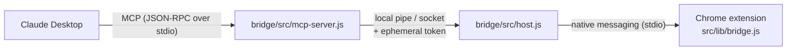

# Claude Desktop ⇄ Chrome bridge (MCP)

Lets **Claude Desktop, with your Claude session** (subscription, no API key), read and group your Chrome tabs through
the AI Tab Grouper extension.

## Contents

- [How it works](#how-it-works)
- [Requirements](#requirements)
- [Installation (once)](#installation-once)
- [Usage](#usage)
- [Security](#security)
- [Troubleshooting](#troubleshooting)
- [Tests](#tests)

## How it works

The bridge is a chain of three local hops between Claude Desktop and the extension.



- Claude Desktop runs with your session and starts `mcp-server.js`, which has 0 dependencies.
- The MCP server reaches `host.js` over local IPC (a named pipe, or a Unix socket with mode 0600) protected by a token.
- Chrome launches `host.js`, and only for this extension. The extension's service worker connects to it through native
  messaging and applies the result with `chrome.tabGroups`.

Claude Desktop never hands credentials to this code: the reasoning happens in your Claude session and only tool calls
arrive here.

## Requirements

- Node.js ≥ 20 (the absolute path of the binary you run the installer with is used).
- Chrome (or Edge/Chromium) with the extension installed.
- Claude Desktop.

## Installation (once)

1. Extension → **Settings** → *Claude Desktop* section → copy the **extension ID**.
2. In this folder:

   ```bash
   node install.mjs --extension-id <ID> --configure-claude
   # Edge: add --browser edge
   ```

   - Registers the native host (Windows: `HKCU\Software\Google\Chrome\NativeMessagingHosts\com.aitabgrouper.bridge`;
     macOS/Linux: JSON in `NativeMessagingHosts/`).
   - Adds `ai-tab-grouper` to `mcpServers` in `claude_desktop_config.json` (with a backup; your other servers are kept).
3. Restart Claude Desktop.
4. Extension → Settings → accept the **data notice** → enable **"Enable Claude Desktop bridge"** (Chrome will ask for
   the "communicate with native applications" permission) → **"Save"**. Status: *"Connected to the local host"*.

Verify with `node doctor.mjs` (all PASS). Do not move the folder after installing (or run the installer again).
Uninstall: `node install.mjs --uninstall --configure-claude`.

## Usage

In Claude Desktop:

- "Organize my Chrome tabs by topic."
- "Group only the ungrouped tabs in the current window; use English names."
- "List my tabs from all windows and propose groups before applying them." (human review before acting)

MCP tools:

| Tool | Effect | Annotations |
|---|---|---|
| `list_tabs` | Title, domain, redacted path and current group, per window | readOnly |
| `apply_tab_groups` | Creates/reuses groups with the `tabIds` from `list_tabs` | idempotent, non-destructive |
| `ungroup_tabs` | Ungroups a window | **destructive** → Claude asks for confirmation |

To run it on a recurring basis, create a scheduled task in Claude Desktop/Cowork with the prompt "Organize my Chrome
tabs by topic" (requires Chrome to be open).

## Security

| Control | Detail |
|---|---|
| Who launches the host | Only Chrome, and only for the ID in `allowed_origins` |
| Who talks to the host | Local clients holding the session token (256 bits, constant-time comparison); the token is deleted when Chrome closes the port |
| Surface | Allowlist of 4 methods in the host and in the extension; argument validation on both sides |
| Data | Same as the Claude API provider: redacted, no query/fragment, excluded domains never exposed; requires valid consent |
| Indirect prompt injection | `list_tabs` output marked as untrusted and delimited; the extension only accepts eligible ids; maximum action = group/ungroup |
| IT policy | `allowDesktopBridge: false` turns it off; `excludedHosts` and `forbidPathSending` apply here too |
| Supply chain | 0 runtime dependencies |

## Troubleshooting

| Symptom | Action |
|---|---|
| Extension: "Host not installed" | Run the installer with the correct ID; restart Chrome |
| Claude: "Chrome is not open or the Claude Desktop bridge is not enabled…" | Open Chrome; check that the bridge is enabled and its status is *"Connected to the local host"* |
| Claude: "The user has not accepted the data notice…" | Accept the notice in the extension's Settings page |
| Claude does not see the tools | Check `claude_desktop_config.json` and restart Claude Desktop |
| Host logs | Chrome's stderr (`chrome --enable-logging=stderr`) · Claude Desktop MCP logs |

More operational detail (locations, health checks, recovery) is in the [runbook](../docs/runbook.md).

## Tests

```bash
node --test "test/**/*.test.js"   # protocol, contract, MCP, installer, E2E with real processes
```
