# Diagrams

GitHub renders these Mermaid diagrams automatically. This file is the complete catalogue: every diagram that appears in
another document is repeated here unchanged. They complement the prose in [architecture.md](architecture.md).

## Contents

- [System context (C4 level 1)](#system-context-c4-level-1)
- [Components (C4 level 2)](#components-c4-level-2)
- [Sequences](#sequences)
- [State and lifecycle](#state-and-lifecycle)
- [Trust boundaries](#trust-boundaries)

## System context (C4 level 1)

The extension runs inside Chrome on your machine and talks to at most one remote system, and only with consent.

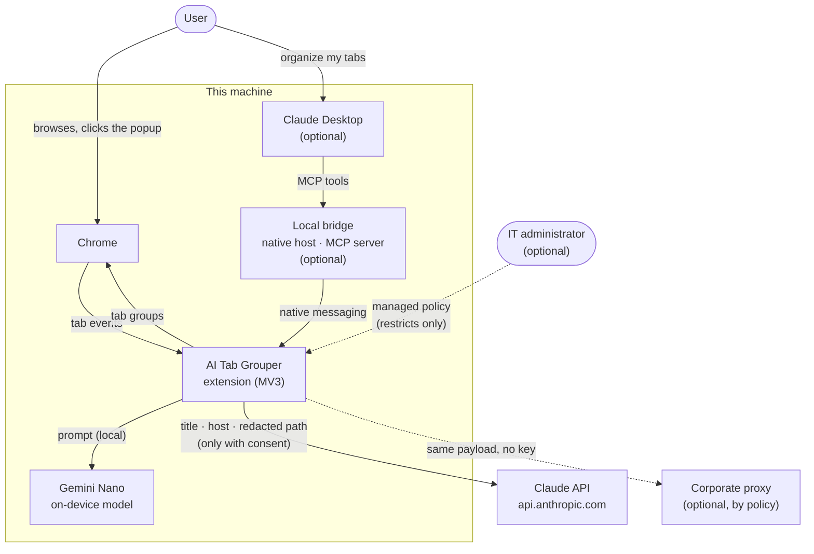

Dotted arrows are optional paths set by an administrator: the corporate proxy replaces the direct call to the Claude
API, and managed policy can only restrict what the extension does.

## Components (C4 level 2)

The extension is a service worker plus two pages; the bridge is two small Node.js processes.

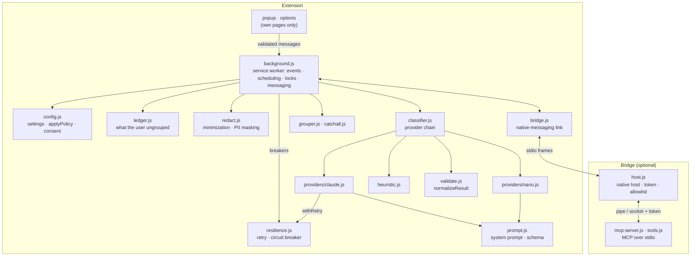

Arrows show who calls whom. `classifier.js` receives the two model providers and the circuit breakers from
`background.js` instead of importing them.

### Module map

The module map shows the same modules together with the Chrome APIs and the external systems they reach.

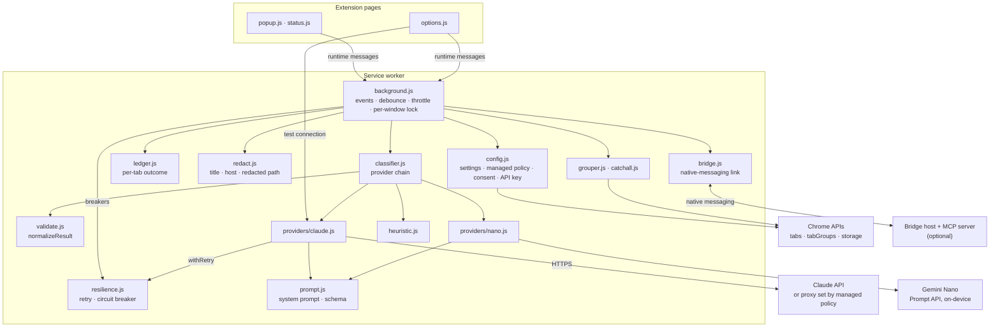

### Import graph

The import graph of the service worker shows the static dependencies; an arrow means "imports".

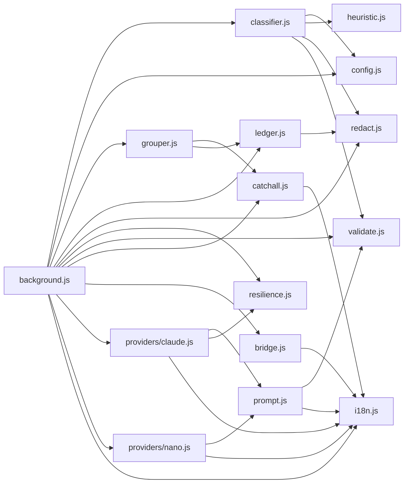

### Bridge

The bridge is a chain of three local hops between Claude Desktop and the extension.

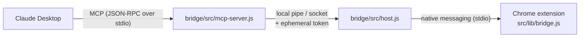

## Sequences

### A grouping run from trigger to tab groups

A grouping run goes from a trigger to tab groups through redaction, the provider chain and validation.

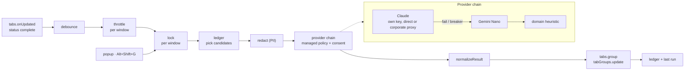

The dotted arrow expands the provider chain: Claude first, then Gemini Nano, then the domain heuristic.

### Automatic grouping

A finished navigation triggers a run on the loose tabs of that window.

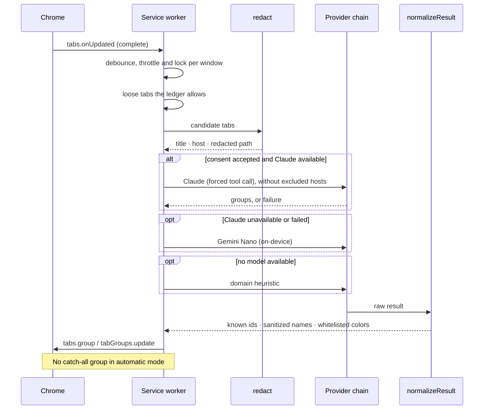

### Provider chain with fallback

The chain tries each engine in the default order and falls through on a skip or a failure.

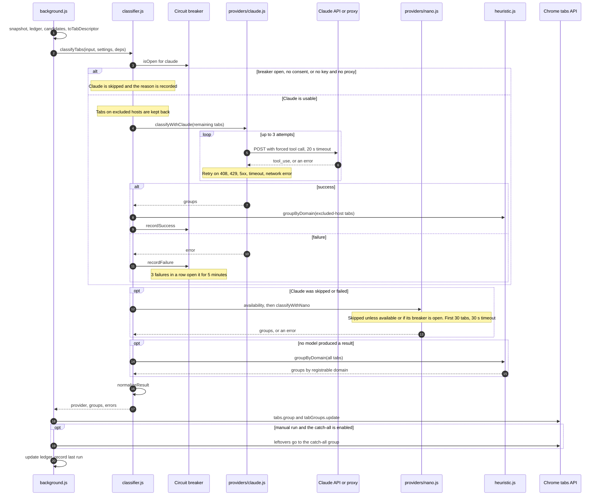

### Claude Desktop groups the tabs

Claude Desktop first lists the tabs and then applies the groups it chose.

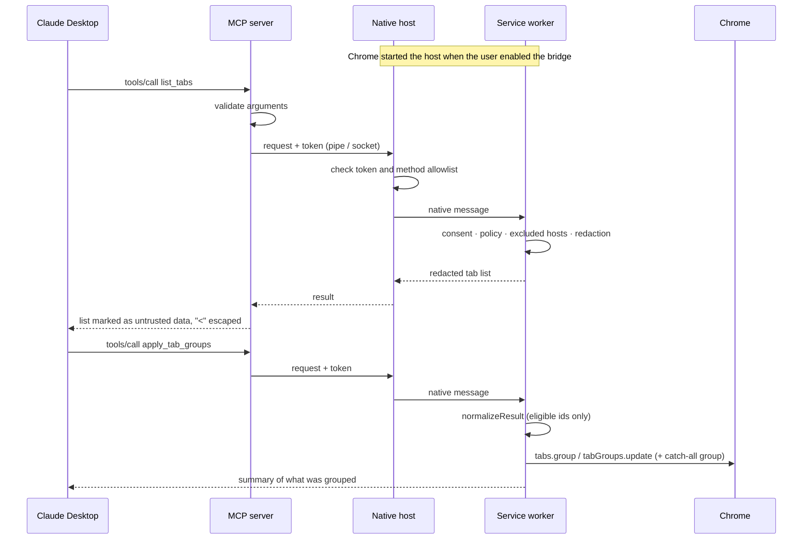

### A bridge tool call

A tool call travels from Claude Desktop to the Chrome tabs API and is checked at every hop.

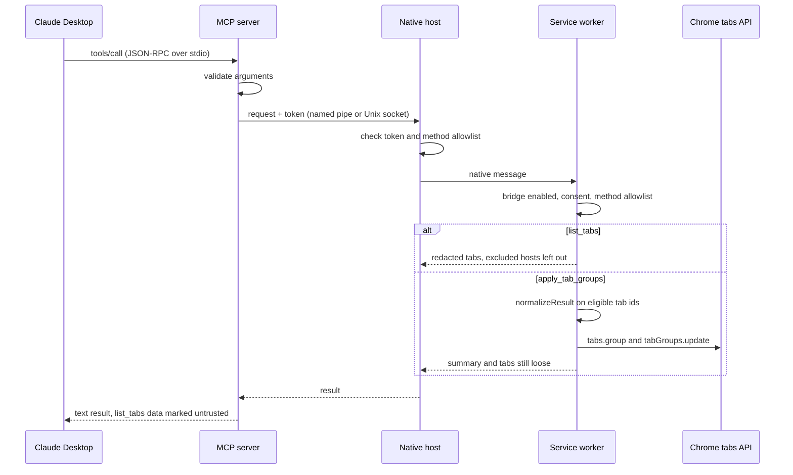

## State and lifecycle

### Circuit breaker

Each model provider has a circuit breaker with three states, persisted in `chrome.storage.session`.

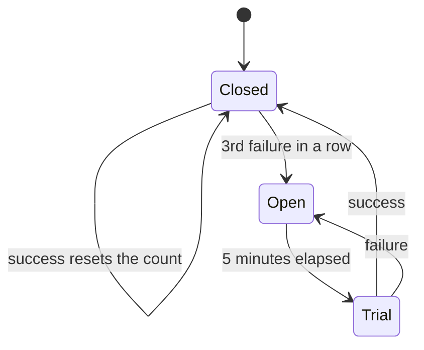

## Trust boundaries

Untrusted input reaches the service worker only through a check, and data leaves the device only with consent.

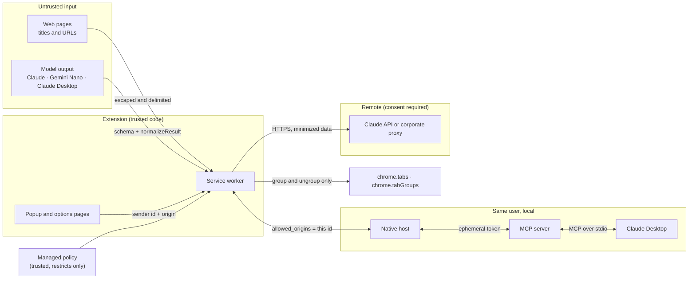

The bridge (native host, MCP server and Claude Desktop) exists only when the user installs and enables it. Whatever a
model answers, the only actions on tabs are grouping and, through the bridge, ungrouping.
