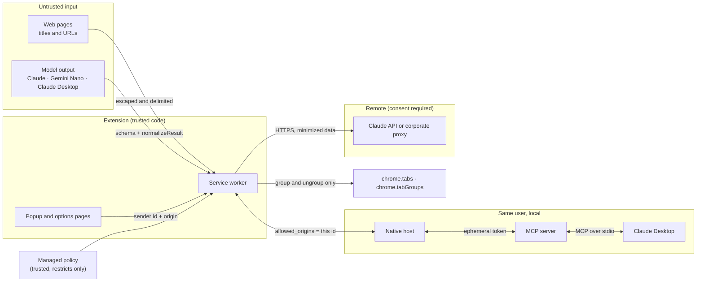

# Threat model

STRIDE and OWASP LLM Top 10 analysis of AI Tab Grouper. Applies to version 1.4.2.

## Contents

- [Assets](#assets)
- [Trust boundaries](#trust-boundaries)
- [STRIDE](#stride)
- [Supply chain](#supply-chain)
- [Accepted risks](#accepted-risks)
- [Out of scope](#out-of-scope)
- [Review](#review)

## Assets

| Asset | Classification |
|---|---|
| Tab titles/URLs (browsing activity) | Confidential (may contain PII, business data) |
| Anthropic API key (BYOK) | Secret |
| Integrity of the tab organization | Low |

## Trust boundaries

Untrusted input reaches the service worker only through a check, and data leaves the device only with consent.

The bridge (native host, MCP server and Claude Desktop) exists only when the user installs and enables it. Whatever a
model answers, the only actions on tabs are grouping and, through the bridge, ungrouping.

The same diagram is in [DIAGRAMS.md](DIAGRAMS.md#trust-boundaries). The red-team pass over these controls is in
[ADVERSARIAL_REVIEW.md](ADVERSARIAL_REVIEW.md).

## STRIDE

### Extension

| # | STRIDE / OWASP | Threat | Control | Residual risk |
|---|---|---|---|---|
| T1 | Information disclosure · LLM02 | Leak of PII/tokens in URLs to the provider | No query/fragment; email/ID/UUID/number redaction; `sendPath` off by policy; local `excludedHosts`; versioned consent | Low: titles may contain sensitive data → `excludedHosts` / Nano / `allowedProviders` |
| T2 | Information disclosure | API key theft from the profile | Default `storage.session` (memory); policy `apiKeyStorage=session` or `proxyEndpoint` (key off the device); `credentials:'omit'` towards Anthropic | Low with proxy; Medium with persistent BYOK (opt-in) |
| T3 | Tampering · LLM01 | Prompt injection through the page title | `<tabs>` delimiter with `<` escaped; "data, not instructions" system prompt; forced `tool_choice`; `normalizeResult` (known ids, sanitized name, bidi/zero-width removed, color whitelist) | Low: worst case, wrong names or groupings (through the bridge, also ungrouping); tabs are never closed, navigated or read |
| T4 | Elevation of privilege | A page/another extension invokes SW actions | No content scripts or `externally_connectable`; `isTrustedSender` (extension id + origin) | Very low |
| T5 | Tampering | Remote code / XSS in extension pages | Strict CSP; no `innerHTML`; ESLint + `cws-check` block sinks | Very low |
| T6 | Spoofing | Fake proxy / MITM | Proxy only from managed storage (IT), HTTPS only with no embedded credentials; `redirect:'error'` | Low |
| T7 | DoS · LLM10 | Runaway cost / rate limit | Debounce, per-window throttle, `maxTabsPerRequest`, bounded retry, circuit breaker | Low |
| T8 | Repudiation | No traceability of what was sent | The corporate proxy centralizes audit/DLP; the extension does not log tab data | Low with proxy |
| T9 | Supply chain | Compromised dependency | 0 runtime deps; lockfile; `npm audit`; SBOM; CodeQL; Trojan Source scan (see [Supply chain](#supply-chain)) | Low |
| T10 | LLM05/LLM06 | Model output executes actions | Only possible actions: `tabs.group`/`tabGroups.update` on validated ids and, through the bridge, `tabs.ungroup` | Very low |

### Claude Desktop bridge (since 1.2.0)

| # | STRIDE / OWASP | Threat | Control | Residual risk |
|---|---|---|---|---|
| T11 | Tampering · LLM01 (indirect) | A malicious title instructs Claude Desktop to use **other** tools (email, files) | `list_tabs` output marked "untrusted" and delimited with `<` escaped; MCP server instructions; the extension does not expose page content; client-side HITL on sensitive tools | **Medium**: depends on the robustness of the model and on which other MCP servers the user has. Recommend manual tool approval in Claude Desktop |
| T12 | Spoofing / EoP | Another local process connects to the pipe/socket and reads tabs | Ephemeral 256-bit token (0600 file in a 0700 dir), constant-time comparison, 0600 socket, deleted on close | Low (same user = same trust boundary) |
| T13 | Spoofing | Another extension/app launches the host | `allowed_origins` = this ID only; registration in HKCU/the user's profile | Very low |
| T14 | Tampering | Claude sends arbitrary ids / other windows | Validation in MCP and in the extension; eligible ids only (not pinned, http(s), not excluded) | Very low |
| T15 | DoS | Huge messages / flood | Limits: 1 MB host→Chrome, 8 MB Chrome→host, 4 MB per IPC line, 8 clients, 15-20 s timeouts, max. 200 tabs | Low |

## Supply chain

Threat T9 covers a compromised dependency. The controls, as listed in [SECURITY.md](../SECURITY.md#security-model) and
[TESTING.md](TESTING.md#static-checks):

- Zero runtime dependencies, in the extension and in the bridge.
- A lockfile under version control; dev dependencies audited with `npm audit` (0 high or critical) and dependency review
  on pull requests.
- A CycloneDX SBOM built in CI.
- CodeQL (`security-and-quality`) on the code and on the workflow files.
- CI actions pinned by commit SHA.
- A Trojan Source scan for bidirectional and zero-width characters in the code.

## Accepted risks

- Persistent BYOK (`storage.local`) is a user opt-in and can be disabled by policy. See [ADR
  0002](adr/0002-enterprise-hardening.md).
- `connect-src https:` in the CSP to allow the configurable proxy; compensated because the endpoint can only come from
  managed policy and there is no remote code.

## Out of scope

- An attacker already running as the same OS user with file access. They can read the bridge token and the browser
  profile, and so already win (see the attacker model of the [adversarial
  review](ADVERSARIAL_REVIEW.md#attacker-model)).
- Building and operating the corporate proxy, which is out of scope for the extension ([ADR
  0002](adr/0002-enterprise-hardening.md)). Its contract is in
  [ENTERPRISE_DEPLOYMENT.md](ENTERPRISE_DEPLOYMENT.md#4-proxy-contract).

## Review

Last reviewed: 2026-11-20, against version 1.4.2.

Review on every change to: data sent (→ bump `CONSENT_VERSION`), permissions, providers or CSP.
