# Architecture

AI Tab Grouper is a Manifest V3 Chrome extension with no runtime dependencies. It groups tabs by topic using a chain of
three engines and, optionally, lets Claude Desktop drive the grouping through a local bridge.

Every diagram of this document is repeated in [DIAGRAMS.md](DIAGRAMS.md), the complete catalogue. For the path of a
grouping run from trigger to tab groups, start with [Flows](#flows).

## Contents

- [Context](#context)
- [Components](#components)
- [Triggers and scheduling](#triggers-and-scheduling)
- [Candidate selection and the ledger](#candidate-selection-and-the-ledger)
- [Data minimization](#data-minimization)
- [Provider chain](#provider-chain)
- [Resilience](#resilience)
- [Validation and application](#validation-and-application)
- [Settings, policy and consent](#settings-policy-and-consent)
- [Messages from the extension pages](#messages-from-the-extension-pages)
- [Claude Desktop bridge](#claude-desktop-bridge)
- [Localization](#localization)
- [Limits](#limits)
- [Flows](#flows)
- [State](#state)
- [Design patterns](#design-patterns)
- [Invariants](#invariants)
- [Decisions](#decisions)

## Context

The extension runs inside Chrome on your machine and talks to at most one remote system, and only with consent.

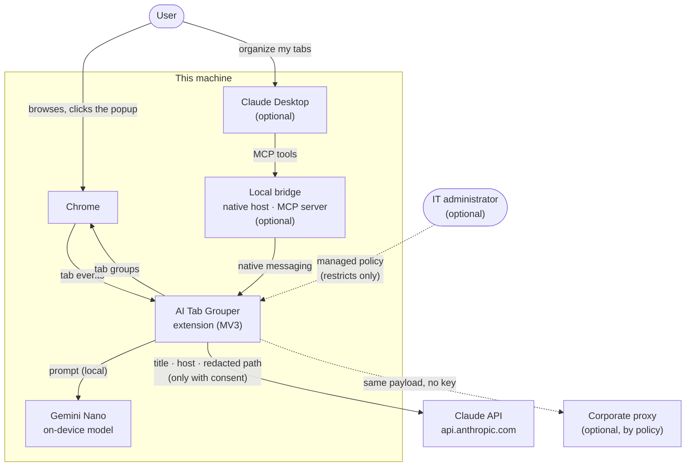

Dotted arrows are optional paths set by an administrator: the corporate proxy replaces the direct call to the Claude
API, and managed policy can only restrict what the extension does.

## Components

The extension is a service worker plus two pages; the bridge is two small Node.js processes.

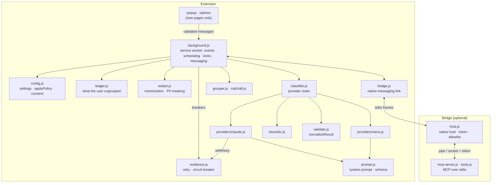

Arrows show who calls whom. `classifier.js` receives the two model providers and the circuit breakers from
`background.js` instead of importing them.

| Module | Responsibility |
|---|---|
| `src/background.js` | Service worker: events, scheduling, per-window locking, messaging with sender validation, bridge handlers |
| `src/lib/config.js` | Settings, managed policy (`applyPolicy`), consent version, API key storage |
| `src/lib/classifier.js` | Provider chain and circuit breaker (injected dependencies, testable without Chrome) |
| `src/lib/providers/claude.js` | Messages API with a forced tool call; own-key or proxy mode (no key) |
| `src/lib/providers/nano.js` | On-device Prompt API with a response schema |
| `src/lib/heuristic.js` | Offline fallback by registrable domain |
| `src/lib/redact.js` · `validate.js` | Input minimization · validation of model output |
| `src/lib/resilience.js` | Retry with jitter and `retry-after`; persisted circuit breaker |
| `src/lib/ledger.js` | Remembers what the user ungrouped |
| `src/lib/catchall.js` · `grouper.js` | Catch-all group ("Misc" / "Varios", recognized across languages) · applying groups to tabs |
| `src/lib/bridge.js` | Native-messaging link to the local bridge host, with backoff |
| `src/lib/prompt.js` | Prompt construction with escaped, delimited tab data |
| `src/popup/status.js` | Pure mapping from service-worker status to popup messages |
| `src/lib/i18n.js` | Message lookup (`t`), browser-language and group-name-language resolution, tokenizer for the inline markup of messages |
| `src/ui/localize.js` | Fills the popup and options pages from `data-i18n*` attributes and sets `<html lang>` (no inline script, no HTML sink) |
| `_locales/en` · `_locales/es` | Message catalogues: English (default locale) and Spanish |
| `bridge/` | Optional native host, MCP server, installer and `doctor` |

### Module map

The module map shows the same modules together with the Chrome APIs and the external systems they reach.

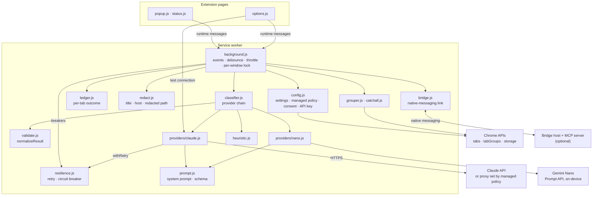

### Import graph

The import graph of the service worker shows the static dependencies; an arrow means "imports".

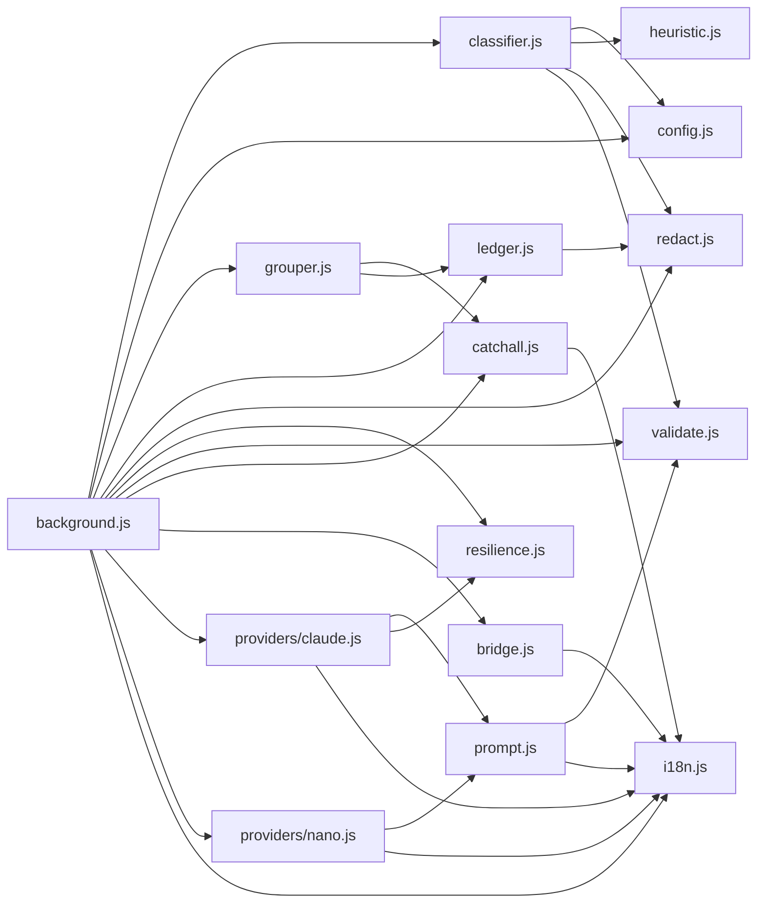

`classifier.js` does not import the providers. `background.js` passes them in a `deps` object together with
`breakerFor`, `nanoAvailability` and the API-key lookup, which is what lets the chain run in tests without Chrome.

## Triggers and scheduling

| Trigger | Mode | Tabs considered |
|---|---|---|
| `tabs.onUpdated` with `status: complete` on a loose, unpinned `http(s)` tab | `auto` | Loose tabs the ledger allows |
| Popup "Group now", `Alt+Shift+G` | `ungrouped` | Every loose tab of the window |
| Popup "Reorganizar todo" (reorganize all) | `all` | Every tab of the window, grouped or not |
| Claude Desktop, `apply_tab_groups` | `desktop` | See [Claude Desktop bridge](#claude-desktop-bridge) |

Pinned tabs and tabs whose URL is not `http(s)` are never candidates.

Automatic runs are controlled per window:

- **Debounce.** Each trigger restarts a timer of `debounceMs`.
- **Throttle.** A run that would start less than `minIntervalMs` after the previous automatic run of that window is
  rescheduled for the remaining time.
- **Lock.** One run per window at a time. An automatic trigger during a run asks for one more run when it ends; a manual
  request during a run is answered with an error.

Timers, the lock and the throttle clock are in memory only. If the service worker restarts they are lost, which at worst
causes one extra or earlier run.

## Candidate selection and the ledger

The ledger records, per tab id, the host and one of three outcomes:

| Outcome | Meaning | Effect on automatic runs |
|---|---|---|
| `grouped` | The extension placed the tab in a group | — (the tab is no longer loose) |
| `left` | A run saw the tab and left it loose | Still sent as context, but does not trigger a run by itself |
| `user` | The user took the tab out of a group the extension made | Not sent again until the tab navigates to another host |

An automatic run is skipped when no candidate is new (no ledger entry, or a different host than recorded), and when the
window has no groups and there are fewer candidates than `minGroupSize`. Candidates are capped at `maxTabsPerRequest`.
Entries are removed when a tab closes. Ledger writes go through a promise chain so that concurrent events do not
overwrite each other.

## Data minimization

`toTabDescriptor` in `redact.js` builds what a model may see of a tab:

| Field | Content |
|---|---|
| `id` | Chrome tab id |
| `title` | Title with emails, UUIDs, tokens of 24 or more characters and long digit runs masked, truncated to 120 characters. Empty when the title is just the address (pages without a `<title>`) |
| `host` | Lowercase hostname without a leading `www.` |
| `path` | Only if `sendPath` is on: the first four path segments, masked the same way, truncated to 60 characters |

The query string and the fragment are never included. Masking scans at most 2,048 characters of input. Titles of
existing groups are sent as context; a remote provider does not receive the titles of groups that hold a tab on an
excluded host.

## Provider chain

`resolveProviderOrder` builds the order from the settings: Claude then Gemini Nano, or the reverse with
`preferOnDevice`, each only if enabled, and the heuristic last if enabled. `classifyTabs` tries each in turn:

| Provider | Skipped when | Call |
|---|---|---|
| Claude | Its breaker is open; the current consent version is not accepted; there is neither a proxy endpoint nor a usable API key | `POST` to the Messages API (or the proxy) with a forced tool call whose input schema is the grouping schema |
| Gemini Nano | Its breaker is open; `LanguageModel.availability()` is not `available` | Prompt API session with the same system prompt and the schema as `responseConstraint` |
| Domain heuristic | Never | Groups by registrable domain, with product names for a few multi-product hosts |

A provider that throws is recorded as a failure and the chain moves on. The first provider that returns a result ends
the chain. If none does, the result has provider `none` and no groups, and the popup reports that no engine was
available.

Before a Claude call, tabs on excluded hosts are separated: only the others are sent, and the excluded ones are grouped
by domain locally and merged into the result. Gemini Nano and the heuristic receive all candidates, since they run on
the device.

In proxy mode (`proxyEndpoint` from managed policy) the request carries no API key and is sent with
`credentials: 'include'`; direct calls carry the user's key and are sent with `credentials: 'omit'`. Both use
`redirect: 'error'`.

The sequence is in [Provider chain with fallback](#provider-chain-with-fallback).

## Resilience

Each model provider has a circuit breaker with three states.

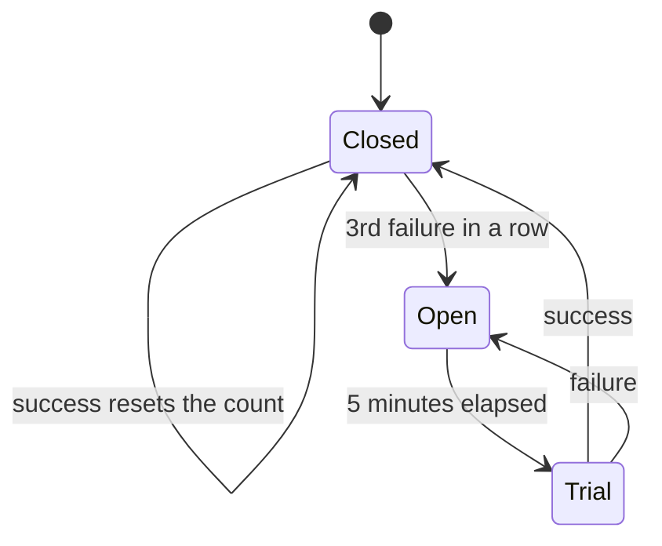

- **Retry** (`withRetry`, used by the Claude provider): up to 2 extra attempts on timeouts, network errors, HTTP 408,
  429 and 5xx. The delay is the server's `retry-after` when present, otherwise exponential backoff with jitter from 500
  ms, capped at 8 s. Other 4xx responses are not retried.
- **Timeouts:** 20 s per Claude request, 30 s per Gemini Nano prompt.
- **Circuit breaker** (`CircuitBreaker`): one per model provider (`claude`, `nano`), with its state in
  `chrome.storage.session` so that it survives service-worker restarts. A provider that is skipped (no consent, no key,
  not available) does not count as a failure. The heuristic has no breaker. After the 5 minutes calls are tried again; a
  failure opens it again. "Test connection" in the options page resets it.
- **Applying groups:** tabs closed since classification are skipped, and an error on one group (for example while the
  user drags a tab) is logged and does not stop the others.

## Validation and application

`normalizeResult` treats model output as untrusted input:

- Group names lose control, zero-width and bidirectional characters, have whitespace collapsed and are cut to 24 code
  points; empty names are dropped.
- Tab ids must be integers among the tabs that were sent; each tab is used once, in the first group that names it.
- A color outside Chrome's nine is replaced by one derived from the name, so the same topic keeps its color across runs.
- Names that differ only in case are merged; a name matching an existing group reuses that group's exact title.
- A new group smaller than `minGroupSize` is dropped; an existing group accepts any number of tabs.

`applyGroups` then adds tabs to the existing group with that title or creates the group and sets its title and color. In
manual runs, `groupLeftovers` puts what is still loose into the catch-all group (grey, collapsed), reusing an existing
group with that name.

## Settings, policy and consent

- User settings live in `chrome.storage.sync` under one key and are merged over the defaults in `config.js`.
- Managed policy (`chrome.storage.managed`, schema in `managed_schema.json`) is overlaid by `applyPolicy` on every read.
  It can turn providers off, add excluded hosts, forbid sending paths, disable automatic grouping, disable the bridge,
  restrict models, forbid or constrain API-key storage, and set a proxy endpoint (HTTPS, no embedded credentials).
  Fields fixed by policy are reported as locked and the options page disables them.
- `CONSENT_VERSION` is raised whenever what is sent, or to whom, changes. The Claude provider and every bridge call
  require the stored `consentVersion` to be at least that value.

## Messages from the extension pages

The service worker accepts runtime messages only from this extension's own pages: the sender id must be the extension's
and the sender URL must start with the extension's origin.

| `type` | Sent by | Effect |
|---|---|---|
| `group` | Popup | Runs a manual grouping of the given window (`all: true` to reorganize everything) |
| `ungroup` | Popup | Takes every tab of the window out of its group |
| `status` | Popup, options page | Returns the last run, engine availability, breaker and bridge status |
| `reset-breakers` | Options page, after a successful connection test | Closes both breakers |

## Claude Desktop bridge

The bridge is a chain of three local hops between Claude Desktop and the extension.

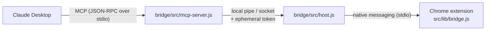

Chrome launches the native host when the extension connects, and only the extension id listed in `allowed_origins` can
launch it. The host exposes a token-protected local endpoint (a named pipe on Windows, a Unix socket elsewhere) that the
MCP server uses to relay three tools: `list_tabs`, `apply_tab_groups` and `ungroup_tabs`. Both the host and the
extension enforce the same method allowlist. See [bridge/README.md](../bridge/README.md) and [ADR
0003](adr/0003-claude-desktop-mcp-bridge.md).

On the extension side:

- The link is started only when the bridge is enabled in the settings, policy allows it and the optional
  `nativeMessaging` permission is granted. It reconnects with exponential backoff up to 60 s, and stops retrying when
  the host is not installed.
- Every tool call re-checks that the bridge is enabled and that the current consent version is accepted.
- `list_tabs` returns the same redacted descriptors as the provider chain, leaves out tabs on excluded hosts and the
  titles of groups that hold them, and reports how many tabs were left out.
- `apply_tab_groups` accepts only tab ids that `list_tabs` could have returned for that window, runs them through
  `normalizeResult`, applies the catch-all unless the call or the settings turn it off, and answers with what was
  grouped, what was ignored and what is still loose.

The sequences are in [Claude Desktop groups the tabs](#claude-desktop-groups-the-tabs) and [A bridge tool
call](#a-bridge-tool-call).

## Localization

Decision record: [ADR 0004](adr/0004-internationalization.md).

| What | Language | Source |
|---|---|---|
| Popup, options page, errors shown to the user, manifest name, description and shortcut | Browser UI language: English (default locale) or Spanish | `_locales/<locale>/messages.json` through `t()` and `data-i18n*` |
| Generated group names | The `language` setting: `auto` (browser UI language, reduced to `en` or `es`), `en` or `es` | `resolveLanguage` in `src/lib/i18n.js`, used by `prompt.js`, `providers/nano.js` and `catchall.js` |
| Catch-all group title | Same as group names: "Misc" or "Varios" | `CATCH_ALL_NAMES` in `src/lib/catchall.js` |
| Instructions to models, `managed_schema.json`, bridge CLI and MCP server | English only | Source code |

- Pages contain no copy. `localizePage()` runs first in `popup.js` and `options.js`, fills the marked elements and sets
  `<html lang>`. Messages may use `<b>`, `<code>` and `{slot}`; `parseRich` tokenizes them and the page builds nodes
  with `createElement` and `textContent`, so a translation cannot inject markup.
- The catch-all group is recognized by the title of **any** supported language, preferring the current one, so a window
  keeps a single catch-all group when the browser language or the setting changes.
- The provider chain reports its own skip reasons as codes (`unavailable`, `breaker-open`); `src/popup/status.js` turns
  them into messages. Nothing compares translated text.

## Limits

| Limit | Value | Where |
|---|---|---|
| Tabs per classification | `maxTabsPerRequest` (default 60) | `background.js` |
| Tabs sent to Gemini Nano | 30 | `providers/nano.js` |
| Tabs returned by `list_tabs` | 200 | `background.js` |
| Group name length | 24 code points | `validate.js` |
| Title / path length sent | 120 / 60 characters | `redact.js` |
| Claude response size requested | `max_tokens` 2048 | `providers/claude.js` |
| Bridge request timeout | 15 s in the host, 20 s in the MCP server | `bridge/src/host.js`, `bridge/src/ipc.js` |
| Bridge message sizes | 1 MB host to Chrome, 8 MB Chrome to host, 4 MB per IPC line | `bridge/src/protocol.js` |
| Concurrent bridge clients | 8 | `bridge/src/host.js` |

## Flows

### Grouping pipeline

A grouping run goes from a trigger to tab groups through redaction, the provider chain and validation.

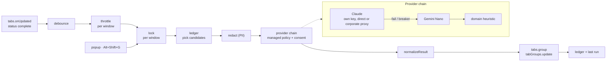

1. **Trigger.** Automatic mode reacts to finished navigations, debounced and throttled per window; manual mode is the
   popup or `Alt+Shift+G`.
2. **Ledger.** A tab the user pulled out of a group is not regrouped until it navigates to another host.
3. **Redaction.** Only the title, the host and optionally the path survive, with emails, tokens, UUIDs and long numbers
   masked. Query and fragment are dropped. Excluded hosts never leave the device.
4. **Policy and consent.** Managed policy can only restrict; no remote call is made without the current consent version.
5. **Provider chain.** Claude API → Gemini Nano (on-device) → domain heuristic. A circuit breaker pauses Claude after
   repeated failures.
6. **Validation.** Model output is forced into a schema and normalized: known tab ids only, sanitized names, whitelisted
   colors, minimum group size.
7. **Catch-all.** In manual mode and from Claude Desktop, tabs no topic claims go to a collapsed grey catch-all group
   ("Misc", or "Varios" when group names are in Spanish). Automatic mode never uses it, so loose tabs can still pair up
   later. A group carrying the catch-all title of any supported language is reused, so changing the language never
   creates a second one.

### Automatic grouping

A finished navigation triggers a run on the loose tabs of that window.

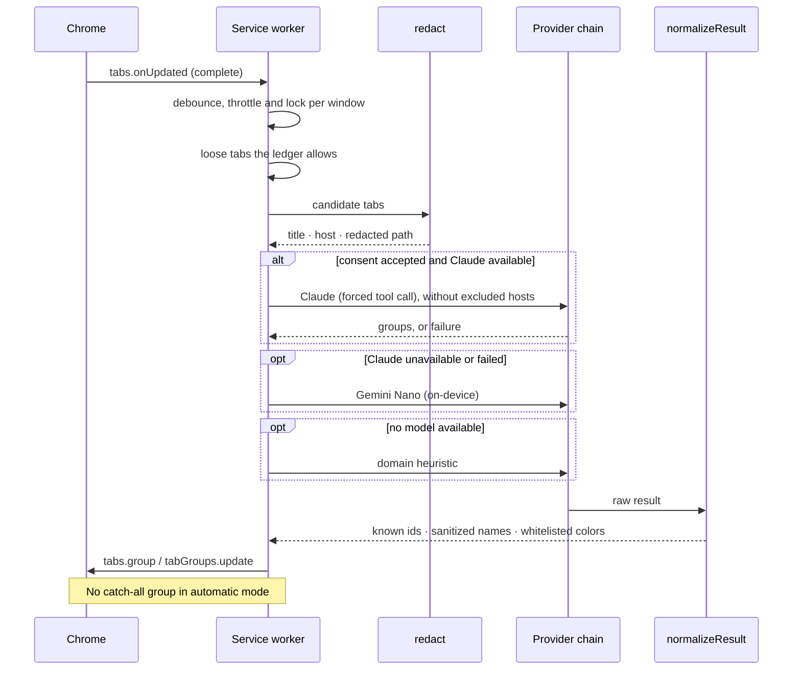

### Provider chain with fallback

The chain tries each engine in the default order and falls through on a skip or a failure.

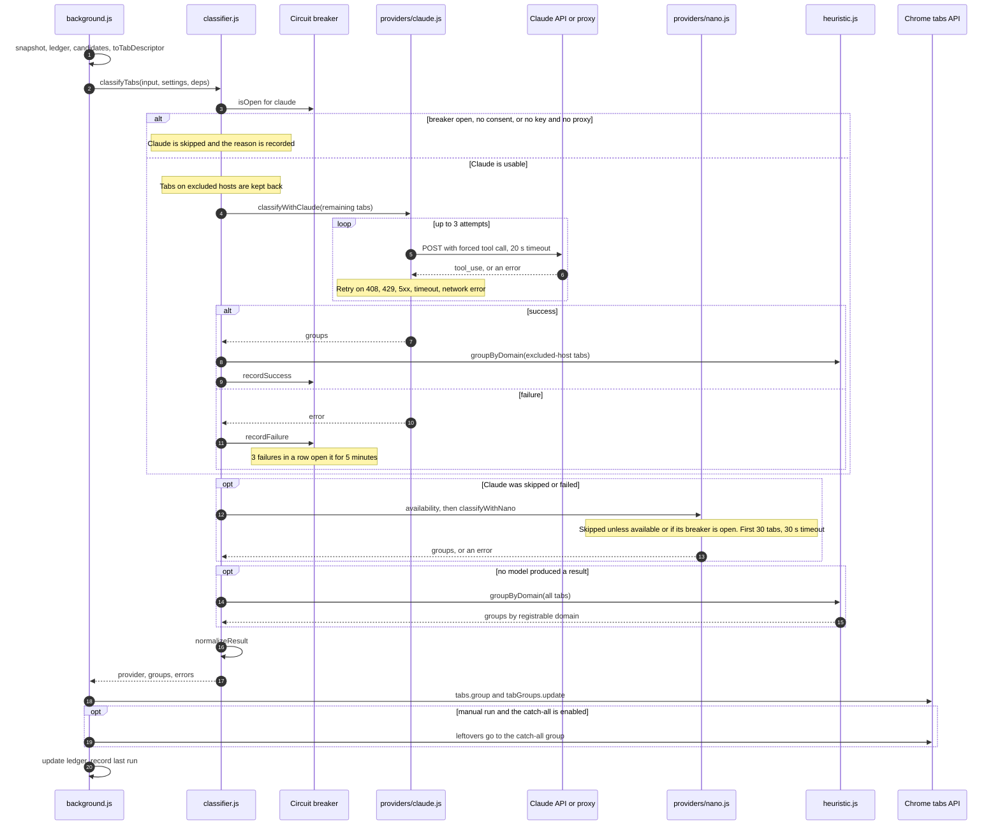

### Claude Desktop groups the tabs

Claude Desktop first lists the tabs and then applies the groups it chose.

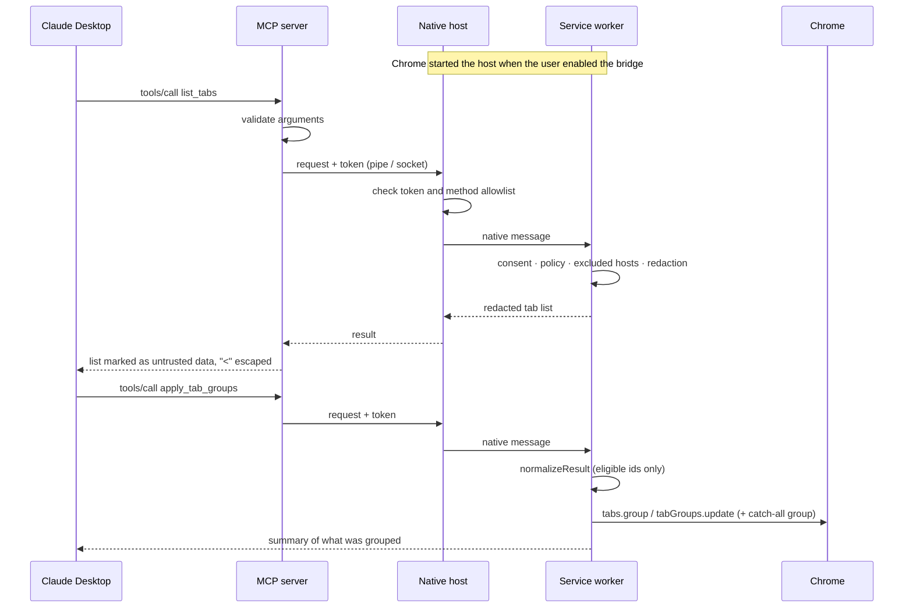

### A bridge tool call

A tool call travels from Claude Desktop to the Chrome tabs API and is checked at every hop.

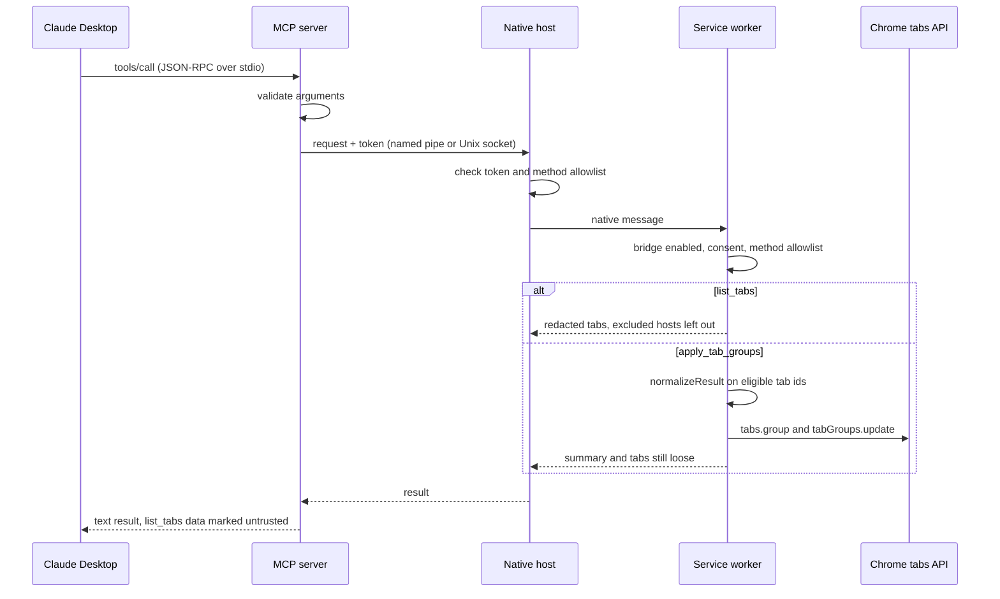

## State

| Data | Where | Lifetime |
|---|---|---|
| User settings, consent version | `chrome.storage.sync` | Persistent, synced by Chrome |
| Managed policy | `chrome.storage.managed` | Set by the administrator, read-only |
| API key | `chrome.storage.session` by default; `chrome.storage.local` if the user opts in | Until the browser closes; persistent if remembered. Never synced |
| Ledger, last run summary, breaker state, bridge status | `chrome.storage.session` | Until the browser closes |
| Timers, per-window lock, throttle clock | Service-worker memory | Until the service worker stops |
| Bridge token and socket | Bridge state directory on disk | While the native host runs |

## Design patterns

| Pattern | Where | Why |
|---|---|---|
| Chain of responsibility | `classifier.js` (`resolveProviderOrder`, `classifyTabs`) | The first provider that returns a result ends the chain; a skip or a failure falls through to the next |
| Dependency injection | The `deps` object that `background.js` passes to `classifier.js` | The chain runs in tests without Chrome |
| Circuit breaker | `CircuitBreaker` in `resilience.js`, one per model provider | Three failures in a row pause a provider for 5 minutes instead of failing every run |
| Retry with backoff and jitter | `withRetry` in `resilience.js` | Transient errors (408, 429, 5xx, timeouts, network) are retried a bounded number of times, honoring `retry-after` |
| Debounce, throttle and per-window lock | `background.js` | Automatic runs stay bounded in number and never overlap in a window |
| Ledger | `ledger.js` | A tab the user ungrouped is remembered, so it is not regrouped |
| Minimize on input, validate on output | `redact.js` before any provider, `validate.js` after | A model sees the minimum and its answer is untrusted |
| Policy overlay | `applyPolicy` in `config.js` | Managed policy restricts the settings on every read |
| Allowlist on both sides | `bridge/src/host.js` and the service worker | A bridge method must be allowed by the host and by the extension |
| Pure mapping | `src/popup/status.js` | Status logic is tested without a browser |

## Invariants

These rules must not be broken. The [ground rules](../CONTRIBUTING.md#ground-rules) state them in full for contributors.

1. No data leaves the device (Claude API, corporate proxy or bridge) without the current consent version accepted.
2. Only the title, the host and optionally the redacted path are sent. The query string and the fragment are never
   included, and tabs on excluded hosts never leave the device.
3. Model output is untrusted, including what Claude Desktop sends back: everything goes through `normalizeResult`.
4. Managed policy only restricts; the single exception is `proxyEndpoint`.
5. The service worker accepts runtime messages only from this extension's own pages.
6. The CSP stays strict: no inline script or style, no remote code, no `eval`, no `innerHTML`.
7. Pinned tabs and tabs whose URL is not `http(s)` are never candidates.
8. A tab the user pulled out of a group is not regrouped until it navigates to another host.
9. The catch-all group applies to manual runs and Claude Desktop, never to automatic mode, and a window keeps a single
   catch-all group across languages.
10. The bridge has zero runtime dependencies, and both the host and the extension enforce the same method allowlist.
11. Nothing logs tab titles or URLs.

## Decisions

Architectural decisions are recorded in [docs/adr/](adr/README.md). Diagrams are in [DIAGRAMS.md](DIAGRAMS.md), the
threat model in [THREAT_MODEL.md](THREAT_MODEL.md) and the red-team pass in
[ADVERSARIAL_REVIEW.md](ADVERSARIAL_REVIEW.md).

| ADR | Decision |
|---|---|
| [0001](adr/0001-hybrid-ai-provider.md) | Hybrid AI provider chain (Claude → Gemini Nano → heuristic) |
| [0002](adr/0002-enterprise-hardening.md) | Enterprise hardening: managed policy, corporate proxy and ephemeral credentials |
| [0003](adr/0003-claude-desktop-mcp-bridge.md) | MCP bridge to Claude Desktop through native messaging |
| [0004](adr/0004-internationalization.md) | Internationalization: English by default, Spanish as a second locale |
